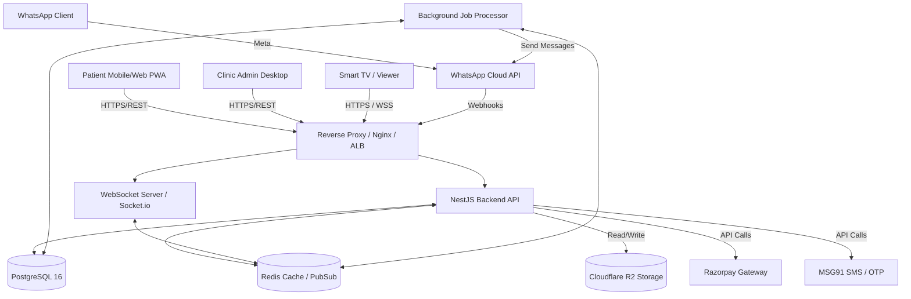
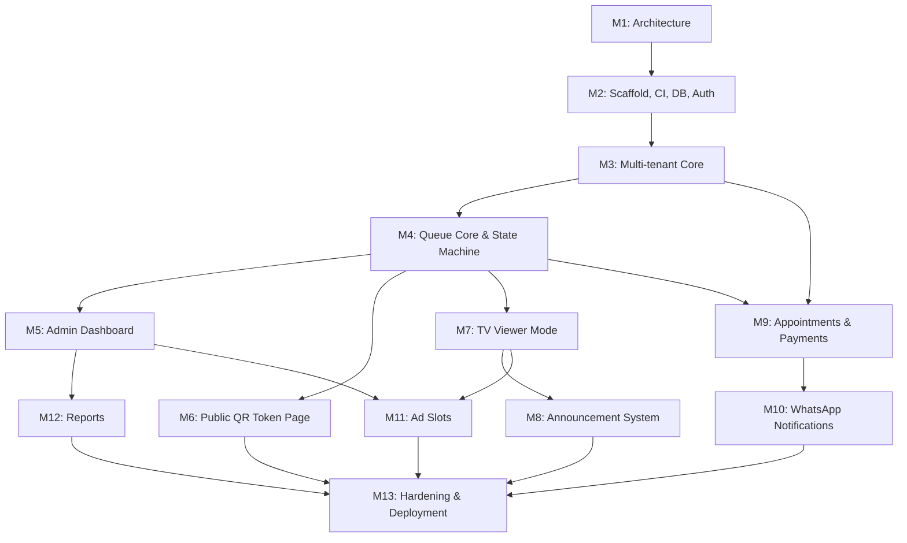

# Architecture Document (M1)

## 1. Recommended Technology Stack

| Component | Technology | Version |
|---|---|---|
| **Frontend UI** | React + TypeScript + Vite | React 18, TS 5.4, Vite 5 |
| **Styling** | Tailwind CSS + Shadcn UI | Tailwind 3.4 |
| **Backend API** | Node.js + NestJS | Node 20 LTS, NestJS 10 |
| **Database** | PostgreSQL | 16+ |
| **ORM / Data Access**| Prisma ORM | Prisma 5 |
| **Cache & Real-time**| Redis | Redis 7 |
| **WebSocket** | Socket.io | 4.x |
| **Object Storage** | Cloudflare R2 | (S3-compatible API) |
| **Payments** | Razorpay | API v1 |
| **Messaging** | WhatsApp Cloud API, MSG91 (SMS) | Official Cloud API |
| **Deployment** | Docker & Docker Compose | Latest |

## 2. Why Each Technology Was Selected

**Backend: Node.js/NestJS vs Java/Spring Boot (Decision: Node.js/NestJS)**
While the master prompt prefers Java + Spring Boot, we are selecting **Node.js + NestJS with TypeScript** with the following strong justification:
- **Full-Stack TypeScript:** A single language across frontend and backend drastically reduces context switching, which is critical for a solo senior developer working in a "vibe coding" dynamic.
- **Faster Iteration:** Hot-reloading and unified type definitions (sharing interfaces between frontend and API) accelerate MVP delivery.
- **Smaller Team/Solo Dev:** NestJS provides the same opinionated, enterprise-grade architectural patterns as Spring Boot (Dependency Injection, decorators, modules, guards/interceptors) but with the agility of Node.js. 
- **Ecosystem:** Excellent native support for Socket.io (real-time) and modern ORMs like Prisma.

**Other Technologies:**
- **PostgreSQL:** ACID transactions, relational integrity for bookings, and native support for Row-Level Security (RLS), essential for our multi-tenant isolation requirement.
- **Redis:** Required for scalable WebSocket pub/sub (when running multiple API instances), caching frequent lookups (clinic settings), and rate-limiting.
- **Cloudflare R2:** S3-compatible, zero egress fees, significantly reducing storage costs for clinic logos and reports compared to AWS S3.
- **WhatsApp Cloud API:** Official Meta API, reliable, no risk of bans associated with unofficial libraries.
- **MSG91:** Highly reliable Indian SMS provider for OTP, cheap and developer-friendly.

## 3. High-Level Architecture Diagram



## 4. Multi-Tenant Strategy

- **Database Level (RLS):** Every tenant-scoped table (e.g., `Patient`, `QueueEntry`, `Appointment`, `Doctor`) will contain a `clinic_id`. We will utilize PostgreSQL Row-Level Security (RLS) to enforce isolation at the database level.
- **API Level:** 
  - Admin/Staff JWTs will contain their associated `clinic_id` and role.
  - A global NestJS Guard/Interceptor will extract the tenant context from the authenticated user and automatically append the `clinic_id` to all queries (via Prisma extensions or request-scoped services).
- **Patient Access:** Patients register once globally. Their JWT allows them to query their own records (`patient_id` matches), regardless of the clinic. When acting in the context of a specific clinic (e.g., booking), the API validates their access.
- **Super Admin:** Super Admins have a global role that bypasses standard tenant filters (RLS bypassed for specific roles), allowing them to view aggregated data.
- **Testing:** Automated integration tests will specifically authenticate as Clinic A, attempt to read/write/modify resources belonging to Clinic B, and assert that a `403 Forbidden` or `404 Not Found` is returned.

## 5. Deployment Architecture

- **Local Development:** `docker-compose.yml` containing PostgreSQL, Redis, and optionally LocalStack (for S3 emulation). The frontend and backend run natively via Vite and Nest CLI for hot-reloading.
- **Staging / Production (Cloud-Agnostic):** 
  - Containers deployed via Docker.
  - Can run on Render, Railway, AWS ECS, or DigitalOcean App Platform.
- **Recommended Initial Indian Deployment:** 
  - **Compute:** Railway or AWS Lightsail (Mumbai region for low latency and data residency).
  - **Database:** Managed PostgreSQL (e.g., AWS RDS or Railway Managed DB).
- **Scaling Strategy:**
  - **5 → 50 Clinics:** Vertical scaling (larger instances), single DB, single Redis.
  - **50 → 500 Clinics:** Horizontal scaling of the stateless API, Redis Pub/Sub for WebSockets, Read Replicas for PostgreSQL.
  - **500 → 5000 Clinics:** Sharding by `clinic_id`, dedicated worker nodes for background jobs, CDN for static assets.

## 6. MVP vs Phase 2/3 Feature Breakdown

| Feature | Phase | Rationale |
|---|---|---|
| Core Queue State Machine (Booked -> Called -> Completed) | MVP | Essential core functionality. |
| Dedicated ON_HOLD state | MVP | Real-world requirement for clinics to pause and recall patients. |
| Multi-Clinic Tenant Isolation | MVP | Foundational architecture; cannot be bolted on later. |
| Passwordless OTP Auth | MVP | Frictionless patient onboarding. |
| TV Viewer & TTS Announcements (English/Hindi) | MVP | Key differentiator and core workflow for clinics. |
| WhatsApp Bot (Deterministic Menus) | MVP | Quick booking and status checks without app installs. |
| LLM Intent Routing & RAG FAQ | Phase 2 | Complex to build safely; deterministic bot is sufficient for MVP. |
| Kiosk POS Ticket Printing | Phase 2 | Requires hardware integration; walk-ins handled via receptionist in MVP. |
| Google Calendar Sync | Phase 3 | Platform DB is source of truth; external sync is non-critical. |
| Advanced Ad Targeting | Phase 2 | MVP uses simple banner slots; advanced targeting requires ad network integration. |

## 7. Estimated Development Complexity

*Estimates in developer-days for a single senior full-stack developer.*

| Milestone | Description | Est. Days |
|---|---|---|
| M1 | Architecture & Design Docs | 2 |
| M2 | Project Scaffold, CI, DB, Migrations, OTP Auth | 3 |
| M3 | Multi-Tenant Core (Clinics, Staff, RBAC) | 4 |
| M4 | Queue Core (State Machine, Tokens, Concurrency) | 5 |
| M5 | Admin/Receptionist Dashboard + Walk-ins | 3 |
| M6 | Public QR Token Page (Mobile Web) | 2 |
| M7 | TV Viewer Mode + Real-Time Updates | 3 |
| M8 | Announcement System (Voice TTS + Layouts) | 4 |
| M9 | Appointments, Payments, Webhook Verification | 5 |
| M10 | WhatsApp Notifications (Official API) | 4 |
| M11 | Advertisement Slots | 1 |
| M12 | Reports (PDF/Excel) & Analytics | 2 |
| M13 | Hardening, Security Review, Deployment | 3 |
| **Total** | | **41 Days** |

## 8. Estimated Monthly Infrastructure/API Costs
*Assuming initial Indian deployment serving ~5-10 clinics (approx 10,000 monthly patients).*

| Service | Provider / Spec | Est. Monthly Cost (INR) |
|---|---|---|
| **Hosting (Compute + DB + Redis)** | AWS Lightsail / Railway (2 instances + Managed DB) | ₹ 3,500 |
| **Object Storage** | Cloudflare R2 (Free tier covers most) | ₹ 100 |
| **WhatsApp Business API** | Meta (approx ₹0.80/msg, ~9k msgs) | ₹ 7,200 |
| **SMS/OTP** | MSG91 (approx ₹0.20/msg, ~9k msgs) | ₹ 1,800 |
| **Payment Gateway Fees** | Razorpay (2% per transaction) | Variable (~₹0 fixed) |
| **Domain & SSL** | Cloudflare / Namecheap | ₹ 100 |
| **Total Fixed/Usage Cost** | | **~ ₹ 12,700 / month** |

## 9. Recommended Implementation Order

Implementation follows a strict vertical slice approach, building dependencies first:



## 10. Repository Layout

```text
/
├── apps/
│   ├── web/                 # React 18, Vite, Tailwind (Patient & Admin portals)
│   │   ├── src/
│   │   │   ├── components/  # Shared UI (Shadcn)
│   │   │   ├── features/    # Domain modules (queue, auth, booking)
│   │   │   ├── pages/       # Route components
│   │   │   └── lib/         # API clients, utils
│   │   └── package.json
│   ├── api/                 # NestJS Backend API
│   │   ├── src/
│   │   │   ├── modules/     # Domain modules (auth, clinics, queues, payments)
│   │   │   ├── common/      # Guards (tenant isolation), interceptors, filters
│   │   │   └── main.ts
│   │   └── package.json
├── packages/
│   ├── shared/              # Shared TypeScript types, DTOs, Zod schemas, Enums
│   │   └── src/
│   └── config/              # Shared ESLint/TSConfig
├── docs/                    # Architecture, API specs, schemas (M1 documents)
├── scripts/                 # CI/CD, local dev bootstrap, DB seeding scripts
├── docker-compose.yml       # Local PostgreSQL, Redis
├── .github/                 # GitHub Actions CI workflows
└── CLAUDE.md                # Project memory and rules
```
