# 02. Database Schema & ERD

> **Status:** Draft — awaiting founder approval before proceeding.
> **Date:** 2026-10-10

This document defines the complete PostgreSQL database schema, including all tables, enums, tenant isolation (RLS), and indexing strategies.

---

## 1. Entity-Relationship Diagram (Mermaid erDiagram)

```mermaid
erDiagram
    %% Core Entities
    Users ||--o| PatientProfiles : "has"
    Users ||--o{ ClinicStaff : "acts as"
    Clinics ||--o{ ClinicStaff : "employs"
    Clinics ||--o{ Doctors : "employs"
    Clinics ||--o{ Services : "offers"
    Clinics ||--o{ Queues : "manages"
    Clinics ||--o{ DisplayDevices : "owns"
    
    %% Relationships
    Doctors ||--o{ Queues : "assigned to"
    Services ||--o{ Queues : "assigned to"
    
    Queues ||--o{ QueueEntries : "contains"
    PatientProfiles ||--o{ QueueEntries : "joins"
    PatientProfiles ||--o{ Appointments : "books"
    
    Appointments ||--o| Payments : "paid via"
    QueueEntries ||--o| Payments : "paid via"
    
    %% Operations & Logs
    Users ||--o{ AuditLogs : "performs"
    Clinics ||--o{ AuditLogs : "tracks"
    QueueEntries ||--o| QRAccessTokens : "has"
    
    %% Messaging & Notifications
    Users ||--o{ Notifications : "receives"
    Clinics ||--o{ WhatsAppConversations : "has"
    Users ||--o{ WhatsAppConversations : "participates"
    WhatsAppConversations ||--o{ WhatsAppMessages : "contains"
    
    %% Announcements
    Clinics ||--o{ Announcements : "creates (if scope=CLINIC)"
    Announcements ||--o{ AnnouncementTranslations : "has"
    Announcements ||--o{ AnnouncementTargets : "targets"
    Announcements ||--o{ AnnouncementSchedules : "scheduled by"
    Announcements ||--o{ AnnouncementDeliveryLogs : "logged in"
    Clinics ||--o{ AnnouncementTemplates : "creates"
    Clinics ||--o| CallAnnouncementSettings : "configures"
    DisplayDevices ||--o{ AnnouncementDeliveryLogs : "delivers"
    
    %% Advertising
    AdvertisementCampaigns ||--o{ Advertisements : "contains"
    Advertisements ||--o{ AdvertisementImpressions : "generates"
    Advertisements ||--o{ AdvertisementClicks : "generates"
    
    %% Platform Administration
    Clinics ||--o| ClinicSettings : "has"
    Clinics ||--o{ Subscriptions : "subscribes"
    Clinics ||--o{ Reports : "generates"
```



---

## 3. Enum Definitions

These are created as PostgreSQL `ENUM` types.

- **QueueEntryStatus**: `BOOKED`, `WAITING`, `CALLED`, `IN_SERVICE`, `COMPLETED`, `SKIPPED`, `CANCELLED`, `NO_SHOW`, `ON_HOLD`
- **PaymentStatus**: `CREATED`, `PENDING`, `SUCCESS`, `FAILED`, `REFUNDED`, `CANCELLED`
- **AnnouncementType**: `INFO`, `NOTICE`, `DELAY`, `CLOSURE`, `HEALTH_TIP`, `EMERGENCY`, `PROMOTION`
- **AnnouncementPriority**: `LOW`, `NORMAL`, `HIGH`, `CRITICAL`
- **AnnouncementDisplayMode**: `TICKER`, `CARD`, `FULLSCREEN_TAKEOVER`
- **AnnouncementAudioMode**: `NONE`, `CHIME`, `VOICE`
- **AnnouncementStatus**: `DRAFT`, `SCHEDULED`, `ACTIVE`, `PAUSED`, `EXPIRED`, `ARCHIVED`
- **AnnouncementScope**: `CLINIC`, `PLATFORM`
- **UserRole**: `SUPER_ADMIN`, `CLINIC_ADMIN`, `RECEPTIONIST`, `DOCTOR`, `PATIENT`

---

## 2. Complete Table Definitions

*Note on Tenant Isolation: All tables belonging to a specific clinic have a `clinic_id` column. Platform-wide tables or super-admin tables omit `clinic_id`.*

### Core Users & Clinics

#### `users`
- **id**: UUID (PK)
- **phone_number**: VARCHAR(20) (UNIQUE, NULLABLE - required for patients)
- **email**: VARCHAR(255) (UNIQUE, NULLABLE - required for admins)
- **password_hash**: VARCHAR(255) (NULLABLE - null for passwordless OTP users)
- **role**: ENUM `UserRole` (DEFAULT 'PATIENT')
- **is_active**: BOOLEAN (DEFAULT TRUE)
- **created_at**: TIMESTAMPTZ (DEFAULT NOW())
- **updated_at**: TIMESTAMPTZ (DEFAULT NOW())

#### `patient_profiles`
- **id**: UUID (PK)
- **user_id**: UUID (UNIQUE, FK `users.id` ON DELETE CASCADE)
- **first_name**: VARCHAR(100)
- **last_name**: VARCHAR(100)
- **date_of_birth**: DATE (NULLABLE)
- **gender**: VARCHAR(20) (NULLABLE)
- **blood_group**: VARCHAR(10) (NULLABLE)
- **created_at**: TIMESTAMPTZ
- **updated_at**: TIMESTAMPTZ

#### `clinics`
- **id**: UUID (PK)
- **name**: VARCHAR(255)
- **address**: TEXT
- **contact_number**: VARCHAR(20)
- **contact_email**: VARCHAR(255)
- **is_active**: BOOLEAN (DEFAULT TRUE)
- **timezone**: VARCHAR(50) (DEFAULT 'Asia/Kolkata')
- **created_at**: TIMESTAMPTZ
- **updated_at**: TIMESTAMPTZ

#### `clinic_staff`
- **id**: UUID (PK)
- **clinic_id**: UUID (FK `clinics.id` ON DELETE CASCADE)
- **user_id**: UUID (FK `users.id` ON DELETE CASCADE)
- **role**: ENUM `UserRole` (CHECK role IN ('CLINIC_ADMIN', 'RECEPTIONIST', 'DOCTOR'))
- **is_active**: BOOLEAN (DEFAULT TRUE)
- **created_at**: TIMESTAMPTZ
- *Unique Constraint*: `(clinic_id, user_id)`

#### `doctors`
- **id**: UUID (PK)
- **clinic_id**: UUID (FK `clinics.id` ON DELETE CASCADE)
- **user_id**: UUID (FK `users.id` ON DELETE SET NULL, NULLABLE)
- **name**: VARCHAR(255)
- **specialization**: VARCHAR(255)
- **is_active**: BOOLEAN (DEFAULT TRUE)
- **created_at**: TIMESTAMPTZ
- **updated_at**: TIMESTAMPTZ

#### `services`
- **id**: UUID (PK)
- **clinic_id**: UUID (FK `clinics.id` ON DELETE CASCADE)
- **name**: VARCHAR(255)
- **description**: TEXT
- **duration_minutes**: INTEGER
- **price**: DECIMAL(10, 2)
- **is_active**: BOOLEAN (DEFAULT TRUE)
- **created_at**: TIMESTAMPTZ
- **updated_at**: TIMESTAMPTZ

### Queues & Appointments

#### `queues`
- **id**: UUID (PK)
- **clinic_id**: UUID (FK `clinics.id` ON DELETE CASCADE)
- **doctor_id**: UUID (FK `doctors.id` ON DELETE SET NULL, NULLABLE)
- **service_id**: UUID (FK `services.id` ON DELETE SET NULL, NULLABLE)
- **name**: VARCHAR(255)
- **token_prefix**: VARCHAR(10) (DEFAULT '')
- **current_token_number**: INTEGER (DEFAULT 0)
- **is_active**: BOOLEAN (DEFAULT TRUE)
- **created_at**: TIMESTAMPTZ
- **updated_at**: TIMESTAMPTZ

#### `queue_entries`
- **id**: UUID (PK)
- **queue_id**: UUID (FK `queues.id` ON DELETE CASCADE)
- **clinic_id**: UUID (FK `clinics.id` ON DELETE CASCADE)
- **patient_profile_id**: UUID (FK `patient_profiles.id` ON DELETE SET NULL, NULLABLE)
- **token_number**: VARCHAR(50)
- **status**: ENUM `QueueEntryStatus` (DEFAULT 'WAITING')
- **hold_reason**: VARCHAR(255) (NULLABLE, required if status is ON_HOLD)
- **priority**: INTEGER (DEFAULT 0)
- **estimated_service_time**: TIMESTAMPTZ (NULLABLE)
- **check_in_time**: TIMESTAMPTZ
- **called_time**: TIMESTAMPTZ (NULLABLE)
- **start_time**: TIMESTAMPTZ (NULLABLE)
- **completion_time**: TIMESTAMPTZ (NULLABLE)
- **created_at**: TIMESTAMPTZ
- **updated_at**: TIMESTAMPTZ
- *Index*: `(queue_id, status)`

#### `appointments`
- **id**: UUID (PK)
- **clinic_id**: UUID (FK `clinics.id` ON DELETE CASCADE)
- **patient_profile_id**: UUID (FK `patient_profiles.id` ON DELETE CASCADE)
- **doctor_id**: UUID (FK `doctors.id` ON DELETE SET NULL, NULLABLE)
- **service_id**: UUID (FK `services.id` ON DELETE SET NULL, NULLABLE)
- **scheduled_time**: TIMESTAMPTZ
- **status**: VARCHAR(50) (e.g., 'SCHEDULED', 'ARRIVED', 'CANCELLED')
- **queue_entry_id**: UUID (FK `queue_entries.id` ON DELETE SET NULL, NULLABLE)
- **created_at**: TIMESTAMPTZ
- **updated_at**: TIMESTAMPTZ

#### `payments`
- **id**: UUID (PK)
- **clinic_id**: UUID (FK `clinics.id` ON DELETE CASCADE)
- **patient_profile_id**: UUID (FK `patient_profiles.id` ON DELETE CASCADE)
- **appointment_id**: UUID (FK `appointments.id` ON DELETE SET NULL, NULLABLE)
- **queue_entry_id**: UUID (FK `queue_entries.id` ON DELETE SET NULL, NULLABLE)
- **amount**: DECIMAL(10, 2)
- **currency**: VARCHAR(10) (DEFAULT 'INR')
- **status**: ENUM `PaymentStatus` (DEFAULT 'CREATED')
- **gateway_order_id**: VARCHAR(255) (NULLABLE)
- **gateway_payment_id**: VARCHAR(255) (NULLABLE)
- **created_at**: TIMESTAMPTZ
- **updated_at**: TIMESTAMPTZ

#### `qr_access_tokens`
- **id**: UUID (PK)
- **queue_entry_id**: UUID (UNIQUE, FK `queue_entries.id` ON DELETE CASCADE)
- **public_token**: VARCHAR(64) (UNIQUE)
- **expires_at**: TIMESTAMPTZ
- **created_at**: TIMESTAMPTZ

### Device & Messaging

#### `display_devices`
- **id**: UUID (PK)
- **clinic_id**: UUID (FK `clinics.id` ON DELETE CASCADE)
- **name**: VARCHAR(255)
- **display_token**: VARCHAR(64) (UNIQUE)
- **config**: JSONB (theme, font_size, language)
- **is_active**: BOOLEAN (DEFAULT TRUE)
- **created_at**: TIMESTAMPTZ
- **updated_at**: TIMESTAMPTZ

#### `notifications`
- **id**: UUID (PK)
- **user_id**: UUID (FK `users.id` ON DELETE CASCADE)
- **type**: VARCHAR(50)
- **message**: TEXT
- **is_read**: BOOLEAN (DEFAULT FALSE)
- **created_at**: TIMESTAMPTZ

#### `whatsapp_conversations`
- **id**: UUID (PK)
- **clinic_id**: UUID (FK `clinics.id` ON DELETE CASCADE)
- **user_id**: UUID (FK `users.id` ON DELETE CASCADE)
- **phone_number**: VARCHAR(20)
- **last_message_at**: TIMESTAMPTZ
- **created_at**: TIMESTAMPTZ

#### `whatsapp_messages`
- **id**: UUID (PK)
- **conversation_id**: UUID (FK `whatsapp_conversations.id` ON DELETE CASCADE)
- **direction**: VARCHAR(10) (CHECK direction IN ('INBOUND', 'OUTBOUND'))
- **message_type**: VARCHAR(20) (e.g., 'TEXT', 'TEMPLATE')
- **content**: JSONB
- **gateway_message_id**: VARCHAR(255) (UNIQUE)
- **status**: VARCHAR(20) (e.g., 'SENT', 'DELIVERED', 'READ')
- **created_at**: TIMESTAMPTZ

### Ads & Reports

#### `advertisement_campaigns`
- **id**: UUID (PK)
- **name**: VARCHAR(255)
- **start_date**: TIMESTAMPTZ
- **end_date**: TIMESTAMPTZ
- **is_active**: BOOLEAN (DEFAULT TRUE)
- **created_at**: TIMESTAMPTZ

#### `advertisements`
- **id**: UUID (PK)
- **campaign_id**: UUID (FK `advertisement_campaigns.id` ON DELETE CASCADE)
- **image_url**: VARCHAR(1024)
- **target_url**: VARCHAR(1024) (NULLABLE)
- **is_active**: BOOLEAN (DEFAULT TRUE)
- **created_at**: TIMESTAMPTZ

#### `advertisement_impressions`
- **id**: UUID (PK)
- **advertisement_id**: UUID (FK `advertisements.id` ON DELETE CASCADE)
- **device_type**: VARCHAR(50) (e.g., 'TV', 'MOBILE')
- **clinic_id**: UUID (NULLABLE, FK `clinics.id` ON DELETE SET NULL)
- **viewed_at**: TIMESTAMPTZ (DEFAULT NOW())

#### `advertisement_clicks`
- **id**: UUID (PK)
- **advertisement_id**: UUID (FK `advertisements.id` ON DELETE CASCADE)
- **user_id**: UUID (NULLABLE, FK `users.id` ON DELETE SET NULL)
- **clicked_at**: TIMESTAMPTZ (DEFAULT NOW())

#### `reports`
- **id**: UUID (PK)
- **clinic_id**: UUID (FK `clinics.id` ON DELETE CASCADE)
- **report_type**: VARCHAR(50)
- **parameters**: JSONB
- **file_url**: VARCHAR(1024) (NULLABLE)
- **status**: VARCHAR(20)
- **created_at**: TIMESTAMPTZ

#### `audit_logs`
- **id**: UUID (PK)
- **clinic_id**: UUID (NULLABLE, FK `clinics.id` ON DELETE CASCADE)
- **user_id**: UUID (NULLABLE, FK `users.id` ON DELETE SET NULL)
- **action**: VARCHAR(100)
- **entity_type**: VARCHAR(50)
- **entity_id**: UUID
- **old_values**: JSONB (NULLABLE)
- **new_values**: JSONB (NULLABLE)
- **created_at**: TIMESTAMPTZ

### Platform Administration

#### `subscriptions`
- **id**: UUID (PK)
- **clinic_id**: UUID (FK `clinics.id` ON DELETE CASCADE)
- **plan_name**: VARCHAR(100)
- **start_date**: TIMESTAMPTZ
- **end_date**: TIMESTAMPTZ
- **is_active**: BOOLEAN (DEFAULT TRUE)
- **created_at**: TIMESTAMPTZ

#### `clinic_settings`
- **id**: UUID (PK)
- **clinic_id**: UUID (UNIQUE, FK `clinics.id` ON DELETE CASCADE)
- **settings**: JSONB
- **updated_at**: TIMESTAMPTZ

### Announcements (Section 51)

#### `announcements`
- **id**: UUID (PK)
- **clinic_id**: UUID (NULLABLE, FK `clinics.id` ON DELETE CASCADE) - Null if PLATFORM scope
- **title**: VARCHAR(255)
- **type**: ENUM `AnnouncementType`
- **priority**: ENUM `AnnouncementPriority`
- **display_mode**: ENUM `AnnouncementDisplayMode`
- **audio_mode**: ENUM `AnnouncementAudioMode`
- **status**: ENUM `AnnouncementStatus`
- **scope**: ENUM `AnnouncementScope`
- **created_by**: UUID (FK `users.id` ON DELETE SET NULL)
- **created_at**: TIMESTAMPTZ
- **updated_at**: TIMESTAMPTZ

#### `announcement_translations`
- **id**: UUID (PK)
- **announcement_id**: UUID (FK `announcements.id` ON DELETE CASCADE)
- **language_code**: VARCHAR(10) (e.g., 'en', 'hi')
- **content_text**: TEXT
- **content_voice**: TEXT (NULLABLE)
- **created_at**: TIMESTAMPTZ
- *Unique Constraint*: `(announcement_id, language_code)`

#### `announcement_targets`
- **id**: UUID (PK)
- **announcement_id**: UUID (FK `announcements.id` ON DELETE CASCADE)
- **target_type**: VARCHAR(50) (e.g., 'ALL_DISPLAYS', 'SPECIFIC_QUEUE')
- **target_id**: UUID (NULLABLE)
- **created_at**: TIMESTAMPTZ

#### `announcement_schedules`
- **id**: UUID (PK)
- **announcement_id**: UUID (FK `announcements.id` ON DELETE CASCADE)
- **start_time**: TIMESTAMPTZ
- **end_time**: TIMESTAMPTZ (NULLABLE)
- **days_of_week**: INTEGER[] (NULLABLE)
- **time_of_day_start**: TIME (NULLABLE)
- **time_of_day_end**: TIME (NULLABLE)
- **repeat_interval_minutes**: INTEGER (NULLABLE)
- **created_at**: TIMESTAMPTZ

#### `announcement_templates`
- **id**: UUID (PK)
- **clinic_id**: UUID (NULLABLE, FK `clinics.id` ON DELETE CASCADE)
- **name**: VARCHAR(255)
- **type**: ENUM `AnnouncementType`
- **template_content**: JSONB
- **created_at**: TIMESTAMPTZ

#### `call_announcement_settings`
- **id**: UUID (PK)
- **clinic_id**: UUID (UNIQUE, FK `clinics.id` ON DELETE CASCADE)
- **is_voice_enabled**: BOOLEAN (DEFAULT TRUE)
- **languages**: VARCHAR[] (DEFAULT '{"en", "hi"}')
- **chime_type**: VARCHAR(50) (DEFAULT 'STANDARD')
- **updated_at**: TIMESTAMPTZ

#### `announcement_delivery_logs`
- **id**: UUID (PK)
- **announcement_id**: UUID (FK `announcements.id` ON DELETE CASCADE)
- **display_device_id**: UUID (FK `display_devices.id` ON DELETE CASCADE)
- **delivered_at**: TIMESTAMPTZ
- **status**: VARCHAR(20)

---

## 4. User-Role Permission Matrix

| Permission | SUPER_ADMIN | CLINIC_ADMIN | RECEPTIONIST | DOCTOR | PATIENT |
| :--- | :---: | :---: | :---: | :---: | :---: |
| **Platform Management** | CRUD | None | None | None | None |
| **Clinic Management** | CRUD | Read, Update | Read | Read | Read |
| **Staff Management** | CRUD | CRUD (own clinic) | None | None | None |
| **Doctor/Service Management**| CRUD | CRUD (own clinic) | Read | Read | Read |
| **Queue Management** | Read | CRUD | CRUD | CRUD (own queue) | Read |
| **Appointment Booking** | Read | CRUD | CRUD | Read | Create, Read, Cancel |
| **Patient Profile** | Read | Read, Update | Read, Update | Read | CRUD (self) |
| **Payments** | Read | Read | Read | Read | Create, Read |
| **Announcements (Clinic)** | Read | CRUD | CRUD | Read | None |
| **Announcements (Platform)** | CRUD | Read | Read | Read | None |
| **ANNOUNCEMENT_EMERGENCY** | Yes | Yes | Yes | No | No |
| **Reports & Analytics** | CRUD | CRUD (own clinic) | None | None | None |
| **Audit Logs** | Read | Read (own clinic) | None | None | None |

---

## 5. Row-Level Security (RLS) Policies

To enforce tenant isolation at the database level, PostgreSQL RLS will be applied to all tables containing a `clinic_id`.

```sql
-- Example RLS Policy for `queue_entries`
ALTER TABLE queue_entries ENABLE ROW LEVEL SECURITY;

-- 1. Super Admins can see everything
CREATE POLICY super_admin_all ON queue_entries
  USING (current_setting('app.current_user_role') = 'SUPER_ADMIN');

-- 2. Clinic Staff can only see/modify entries for their clinic
CREATE POLICY clinic_staff_isolation ON queue_entries
  USING (
    clinic_id = current_setting('app.current_clinic_id')::uuid
    AND current_setting('app.current_user_role') IN ('CLINIC_ADMIN', 'RECEPTIONIST', 'DOCTOR')
  );

-- 3. Patients can only see their own queue entries
CREATE POLICY patient_isolation ON queue_entries
  USING (
    patient_profile_id = current_setting('app.current_patient_id')::uuid
    AND current_setting('app.current_user_role') = 'PATIENT'
  );
```
*(Similar policies will apply to `appointments`, `payments`, `announcements`, etc.)*

---

## 6. Indexes Strategy

**1. Foreign Key Indexes**
- Index all FK columns (e.g., `clinic_id`, `queue_id`, `user_id`) to optimize JOINs and cascaded deletes.

**2. Composite Indexes for Common Queries**
- `queue_entries (queue_id, status)`: For finding the next patient to call (`status = 'WAITING' ORDER BY priority DESC, check_in_time ASC`).
- `appointments (clinic_id, scheduled_time)`: For fetching a clinic's daily schedule.
- `announcements (clinic_id, status)`: For quickly loading active announcements for a display device.
- `announcement_schedules (start_time, end_time)`: For querying active schedules at the current time.

**3. Unique Constraints & Lookups**
- `qr_access_tokens (public_token)`: Indexed automatically by UNIQUE constraint for fast O(1) patient QR lookups.
- `display_devices (display_token)`: Indexed for fast viewer auth.
- `whatsapp_messages (gateway_message_id)`: To ensure idempotent processing of webhooks.

---

## 7. Migration Strategy

- **Tooling**: Flyway or Liquibase (if Java/Spring Boot) or Prisma/Knex (if Node.js).
- **Versioning**: strictly versioned migration files (e.g., `V1__init_schema.sql`, `V2__add_announcements.sql`).
- **Safety**: Schema changes must be reversible. Never run destructive operations (`DROP COLUMN`) without a multi-phase migration ensuring 0-downtime if possible.
- **Transactions**: DDL statements will be executed within transactions to prevent partial migrations.

---

## 8. Seed Data (M2)

To verify the schema and UI during development, the following demo seed data will be injected automatically:

- **2 Clinics**: "City Health Clinic" and "Prime Diagnostics Center".
- **Doctors/Services**: 2 Doctors in Clinic A (General, Dental), 1 Service in Clinic B (Blood Test).
- **Queues**: 3 active queues corresponding to the doctors/services.
- **Patients**: 5 dummy patient profiles.
- **Queue Entries**: Pre-populated queue with mixed states (`IN_SERVICE`, `CALLED`, `WAITING`, `ON_HOLD`).
- **Announcements**: 
  - 1 Active `INFO` platform announcement (e.g., "Welcome to QueueApp").
  - 1 Scheduled `DELAY` announcement for Clinic A ("Dr. Smith is running 15 mins late").
- **Display Device**: 1 TV Display token pre-generated for Clinic A waiting hall.
