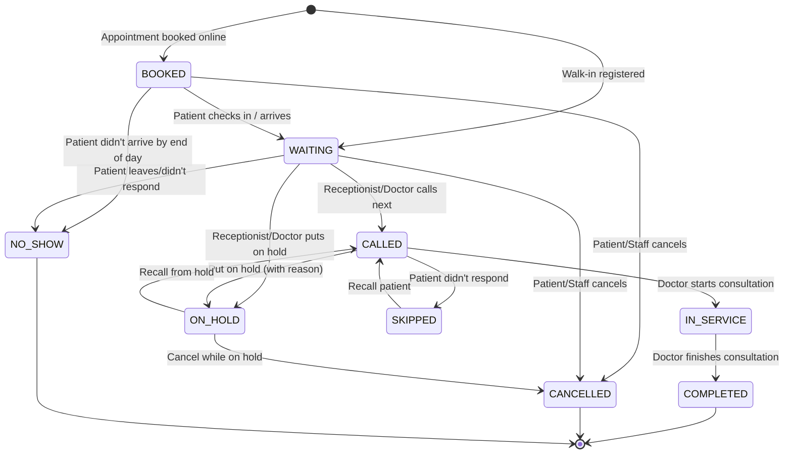
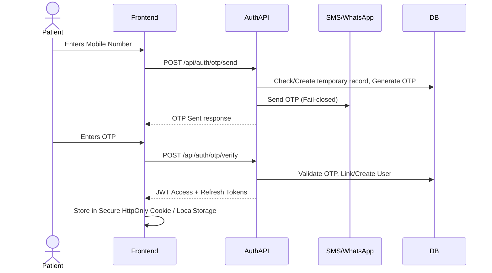
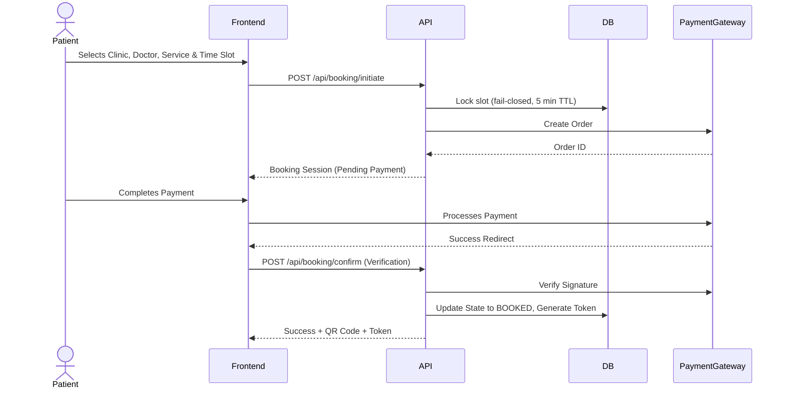

# System Flows & Architectures

This document details the critical user flows, state machines, and subsystem architectures for the multi-clinic queue management platform, ensuring a resilient, scalable, and multi-tenant foundation.

---

## 1. Queue State Machine

The queue state machine governs the lifecycle of a patient's visit.

### State Transitions & Side Effects

| Transition | Triggered By | Side Effects |
|------------|--------------|--------------|
| `* → BOOKED` | Patient (Web/WhatsApp) / Staff | Payment verified, Token generated, WhatsApp confirmation sent. |
| `BOOKED → WAITING` | Patient (QR scan) / Staff | TV Viewer updates, Queue position calculated. |
| `WAITING → CALLED` | Staff (Receptionist/Doctor) | TV Viewer highlights token & sounds chime/TTS, WhatsApp "It's your turn" sent. |
| `CALLED → IN_SERVICE`| Doctor / Staff | TV Viewer removes from "Now Serving", moves to "Last Called". |
| `IN_SERVICE → COMPLETED`| Doctor / Staff | Token archived, review request sent via WhatsApp. |
| `WAITING → CANCELLED`| Patient / Staff | Token removed from TV Viewer, refund initiated (if applicable). |
| `* → NO_SHOW` | System (Cron at EOD) / Staff | Token archived, metrics updated. |
| `CALLED → SKIPPED` | Staff (Receptionist/Doctor) | TV Viewer removes from active, moved to skipped list. |
| `SKIPPED → CALLED` | Staff (Recall) | TV Viewer highlights token again, announcement triggers. |
| `* → ON_HOLD` | Staff | Pauses queue SLA timer. Requires reason (e.g., "Gone for X-ray"). |
| `ON_HOLD → CALLED` | Staff | Restores to active queue, triggers TV announcement. |

---

## 2. Patient Registration & Authentication Flow

We use a passwordless mobile OTP flow to minimize friction.

- **Admin/Staff Login Flow:** Staff log in via Email/Password or SSO, receiving role-based JWTs with specific clinic-level claims for multi-tenancy.
- **Session Management:** Short-lived access tokens (15m) + rolling refresh tokens (7d). Logout revokes refresh tokens in the database.

---

## 3. Appointment Booking Flow

- **Slot Availability (Fail-Closed):** If the DB cannot lock the slot or throws a concurrency error, the system assumes the slot is unavailable to prevent double booking.
- **Token Generation:** Generated only after successful payment verification.

---

## 4. Walk-in Patient Flow

- **Trigger:** Receptionist adds a patient via the Staff Dashboard.
- **Duplicate Detection:** System checks mobile number against today's queue to prevent double-entry.
- **Flow:** Receptionist collects cash/offline payment -> DB directly creates token in `WAITING` state -> TV Viewer updates instantly. No digital payment gateway interaction needed.

---

## 5. Payment Architecture

- **Abstraction Layer:** `PaymentProvider` interface (supports Razorpay, Stripe, Cash).
- **State Machine:** `CREATED` (intent) → `PENDING` (user paying) → `SUCCESS` / `FAILED` → `REFUNDED`
- **Webhook Handling:**
  - Signature verification on all incoming webhooks.
  - Idempotency handled via unique `provider_transaction_id` constraint in DB.
  - Reconcile cron job checks `PENDING` transactions older than 30 mins with the gateway.
- **Frontend Disconnection:** If the patient closes the app after paying, the webhook ensures the appointment is still confirmed and a WhatsApp message is dispatched.

---

## 6. QR Code Architecture

- **Clinic QR:** Static QR placed at the reception. Scans to the clinic's public booking page.
- **Queue QR:** Static QR for walk-in self-check-in (if enabled).
- **Patient Token QR:** Dynamic QR on the patient's phone/receipt. Contains a signed JWT (short-expiry) for staff to scan and pull up patient details.
- **Security:** Public pages are rate-limited by IP. Token lookup requires an exact Match (Clinic ID + Token ID).

---

## 7. WhatsApp Architecture

Using the Official WhatsApp Business Platform (Cloud API).

- **Conversation State Machine:** Managed via a Redis session store (ttl: 24h). States: `IDLE`, `BOOKING_STARTED`, `AWAITING_SLOT`, `AWAITING_PAYMENT`.
- **Menu Structure:** Deterministic interactive buttons/lists (MVP). Free-text routes to human or fallback response.
- **Webhooks:** Asynchronous processing via a message queue to prevent blocking WhatsApp servers. Strict idempotency key checks.
- **Notification Types:** Appointment Confirmation (Template), Queue Turn Approaching (Template), Post-visit Feedback (Template).
- **Phase 2/3 AI Notes:** Future LLM integration will act as an intent router (e.g., classify intent as `BOOK`, `FAQ`, `CANCEL`) before handing off to deterministic flows.

---

## 8. TV Viewer Architecture

- **Authentication:** Devices use a `display_token` (JWT with no user identity, only clinic/display claims). No login required.
- **Real-Time Updates:** WebSocket (STOMP) primary, SSE alternative, long-polling fallback.
- **Resilience:** Auto-reconnect with exponential backoff. On reconnect, does a full state fetch to reconcile missed events.
- **Heartbeat:** Pings server every 30s. Admin dashboard shows offline TVs.
- **Templates (MVP):**
  1. *Now Serving + Next List*
  2. *Last 4 Called*
  3. *Single Large Token*
- **Call-out Audio:** Browser Web Speech API for TTS. Autoplay issues mitigated by requiring a single user interaction (click/tap) on initial TV setup. Background media ducking (lowers volume of generic video ads while announcing).
- **Hardware Profile:** Optimized CSS/JS to run smoothly on low-spec Smart TV browsers (minimum repaints).

---

## 9. Announcement System Architecture

- **Types:** Automatic (system-generated like "Token 12 to Room 2") and Custom (staff-created like "Doctor delayed by 15 mins").
- **Lifecycle:** `DRAFT` → `SCHEDULED` → `ACTIVE` → `PAUSED/EXPIRED` → `ARCHIVED`.
- **Delivery:** Real-time push via WebSocket topic `/topic/clinic/{id}/announcements`.
- **Targeting:** Can target specific displays, all TVs in a clinic, or the patient's tracking page on their phone.
- **TTS:** English + Hindi support.

---

## 10. Advertisement Architecture

- **Component:** `AdvertisementSlot` UI component placed safely away from primary queue numbers. Never obscures queue info.
- **Campaigns:** Configured in Super Admin. Targeted by clinic location or globally.
- **Tracking:** Impressions logged via beacon requests.
- **Format:** Image banners or muted video (auto-paused during announcements).

---

## 11. Estimated Wait Time (EWT) Algorithm

- **Initial Algorithm:** `(Average Service Time for Doctor/Service) × (Number of People Ahead)`
- **Refinement:** System logs actual `CALLED` to `COMPLETED` durations. EWT dynamically updates based on rolling 7-day averages for the specific doctor and time-of-day.

---

## 12. Real-Time Synchronization Strategy

- **Triggers:** Queue state changes, announcements, display settings updates.
- **Topic Design:**
  - `/topic/clinic/{clinicId}/queue` (Public queue updates)
  - `/topic/clinic/{clinicId}/displays` (TV config changes)
  - `/user/{userId}/queue` (Private updates for staff)
- **Fallback:** If WS fails, clients drop to SSE, then 10-second polling.

---
