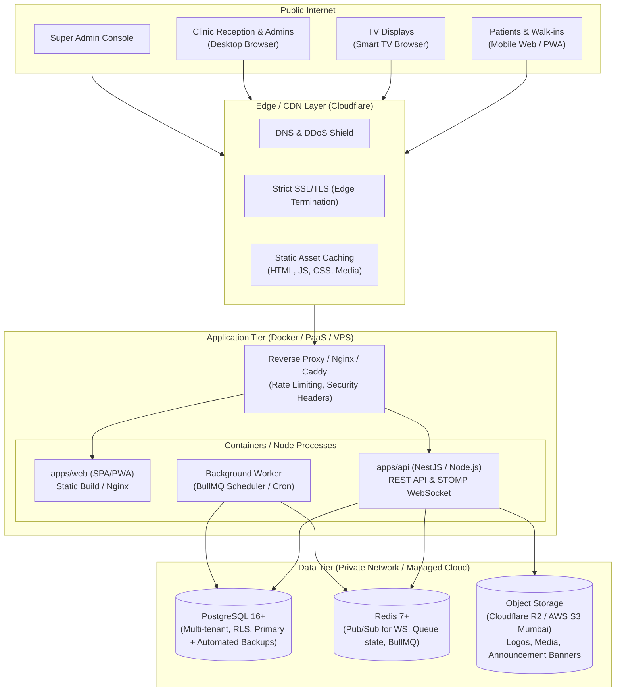
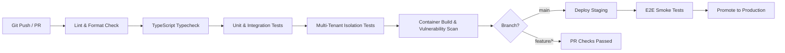

# Deployment Architecture & Operations Guide

> **Document:** `docs/06-deployment.md`  
> **Milestone:** M1 — Architecture & Design  
> **Target Audience:** DevOps, Backend Engineers, Founders

---

## 1. Overview & Principles

This document defines the deployment strategy, container orchestration, environment lifecycle, CI/CD pipeline, and operational procedures for the **Multi-Clinic Queue, Appointment & Announcement Platform**.

Key operational principles:
1. **Cloud-Agnostic & Portable**: Uses standard OCI containers (Docker) so the application runs identically on local workstations, VPS (Hetzner / DigitalOcean), PaaS (Render / Railway), or hyperscalers (AWS / GCP).
2. **Minimal Operational Overhead**: Avoids Kubernetes or complex mesh architectures for MVP and initial growth (< 500 clinics). Single-node or lightweight managed clusters keep monthly operational costs below ₹4,000–6,000 ($50–75).
3. **Zero Downtime Migrations**: Database migrations are strictly additive/backward-compatible to allow blue-green or rolling deploys.
4. **Data Isolation & Security**: Database and cache instances remain in private subnets, never directly exposed to the public internet.

---

## 2. Environment Architecture



---

## 3. Local Development (`docker-compose.yml`)

The local environment mirrors production service topologies using Docker Compose:

```yaml
version: '3.8'

services:
  postgres:
    image: postgres:16-alpine
    container_name: queueapp-postgres
    restart: unless-stopped
    environment:
      POSTGRES_USER: queueapp
      POSTGRES_PASSWORD: queueapp_dev_password
      POSTGRES_DB: queueapp_dev
    ports:
      - "5432:5432"
    volumes:
      - pgdata:/var/lib/postgresql/data
      - ./scripts/init-db.sql:/docker-entrypoint-initdb.d/init.sql
    healthcheck:
      test: ["CMD-SHELL", "pg_isready -U queueapp -d queueapp_dev"]
      interval: 5s
      timeout: 5s
      retries: 5

  redis:
    image: redis:7-alpine
    container_name: queueapp-redis
    restart: unless-stopped
    ports:
      - "6379:6379"
    volumes:
      - redisdata:/data
    healthcheck:
      test: ["CMD", "redis-cli", "ping"]
      interval: 5s
      timeout: 5s
      retries: 5

  minio:
    image: minio/minio:RELEASE.2024-01-18T22-51-28Z
    container_name: queueapp-storage
    restart: unless-stopped
    environment:
      MINIO_ROOT_USER: minioadmin
      MINIO_ROOT_PASSWORD: minioadmin_secret
    command: server /data --console-address ":9001"
    ports:
      - "9000:9000"
      - "9001:9001"
    volumes:
      - miniodata:/data

volumes:
  pgdata:
  redisdata:
  miniodata:
```

### Local Quickstart Runbook
```bash
# 1. Start database, cache, and local object storage
docker compose up -d

# 2. Install dependencies across monorepo
npm install

# 3. Copy environment configurations
cp .env.example .env
cp apps/api/.env.example apps/api/.env
cp apps/web/.env.example apps/web/.env

# 4. Run database migrations & seed test clinics
npm run db:migrate
npm run db:seed

# 5. Start dev servers (Web on 3000, API on 4000)
npm run dev
```

---

## 4. Production Topologies

### Tier 1: Startup MVP (1–50 Clinics)
- **Host**: Single VPS (Hetzner CPX31: 4 vCPU, 8GB RAM, €14/mo OR DigitalOcean Droplet Bangalore: 4GB RAM, $24/mo) OR Managed PaaS (Render / Railway).
- **Database**: Managed PostgreSQL (DigitalOcean / Supabase / Neon) or co-located Postgres with daily automated S3 dumps.
- **Cache**: Managed Redis or co-located Alpine Redis container.
- **Storage**: Cloudflare R2 (zero egress fees, S3 compatible).
- **DNS / SSL**: Cloudflare free plan with full SSL termination and DDoS defense.

### Tier 2: Growth (50–500 Clinics)
- **API Nodes**: 2x Node instances behind an application load balancer (ALB / Caddy).
- **Database**: Dedicated managed PostgreSQL instance with read replica for analytical reports.
- **Cache**: Managed Redis cluster with persistence for WebSockets & BullMQ job dispatch.
- **Worker**: Separated worker container for asynchronous jobs (WhatsApp outbox, PDF reports, announcement scheduling).

---

## 5. CI/CD Workflow (GitHub Actions)

Every pull request and merge to `main` executes a strict verification pipeline:



### GitHub Actions Pipeline Configuration (`.github/workflows/ci.yml`)
1. **Lint & Typecheck**:
   - `npm run lint`
   - `npm run typecheck`
2. **Automated Testing**:
   - Runs Postgres 16 and Redis 7 service containers in the GitHub runner.
   - Executes unit tests and tenant isolation integration tests.
3. **Build Verification**:
   - Compiles `apps/web` (Vite production bundle).
   - Compiles `apps/api` (NestJS production bundle).
4. **Deploy**:
   - Automated deployment webhook or SSH docker-compose trigger with rollback protection.

---

## 6. Zero-Downtime Database Migration Runbook

Database schema updates must strictly preserve zero downtime:
1. **Rule of Backward Compatibility**: Never rename or delete a column in a single release.
   - *Phase 1*: Add new column as nullable, release backend writing to both columns.
   - *Phase 2*: Backfill historic data via background worker.
   - *Phase 3*: Release backend reading from the new column only.
   - *Phase 4*: Drop legacy column in subsequent migration.
2. **Locking Safeguards**:
   - Set statement timeout: `SET statement_timeout = '5s';`
   - Use `CREATE INDEX CONCURRENTLY` for index additions.
3. **Rollback Procedure**:
   - Every migration script `XXX_feature.ts` must implement an idempotent `down()` method.
   - Take an automated DB snapshot prior to executing migrations in production.

---

## 7. Monitoring, Logging & Health Checks

### 1. Health Endpoints
- `GET /health`: Liveness probe (returns HTTP 200 `{ status: "ok" }`).
- `GET /health/ready`: Readiness probe verifying active connections to:
  - PostgreSQL database query (`SELECT 1`)
  - Redis ping
  - Storage connectivity
  - SMS/WhatsApp provider connectivity status

### 2. Structured Logging
- JSON structured format output to `stdout`:
```json
{
  "timestamp": "2026-10-11T00:00:00.000Z",
  "level": "info",
  "traceId": "req_8f9e12a4b",
  "clinicId": "clinic_4920",
  "userId": "usr_9102",
  "method": "POST",
  "path": "/api/admin/queue/next",
  "status": 200,
  "responseTimeMs": 34
}
```
- Ingestion via Promtail/Loki or Grafana Cloud free tier.

### 3. TV Viewer & Smart TV Heartbeat Monitoring
- TV clients ping `/api/viewer/{displayToken}/heartbeat` every 30 seconds.
- Admins see real-time indicator of TV status (`ONLINE`, `DEGRADED`, `OFFLINE`).

---

## 8. Backup & Disaster Recovery (DR)

| Resource | Frequency | Retention | Target Location |
|---|---|---|---|
| PostgreSQL Full Dump | Daily at 02:00 IST | 30 Days | Cloudflare R2 / AWS S3 (Separate Region) |
| PostgreSQL WAL Logs | Continuous (15 min) | 7 Days | Object Storage Point-in-Time Recovery |
| Media / Logos | Upload time sync | Indefinite | Geographically replicated R2 bucket |
| Configuration / Secrets | On change | Git history (encrypted) / HashiCorp Vault / Infisical | Secure vault |

**Recovery Time Objective (RTO)**: < 30 minutes  
**Recovery Point Objective (RPO)**: < 15 minutes
